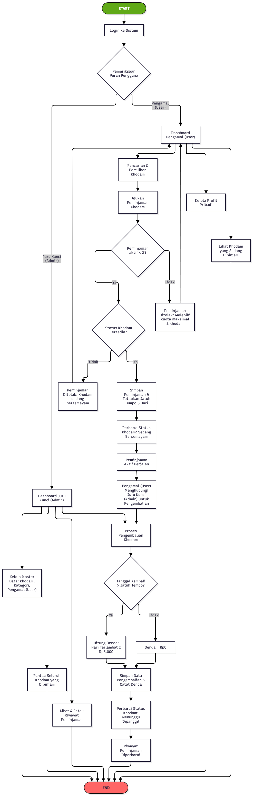
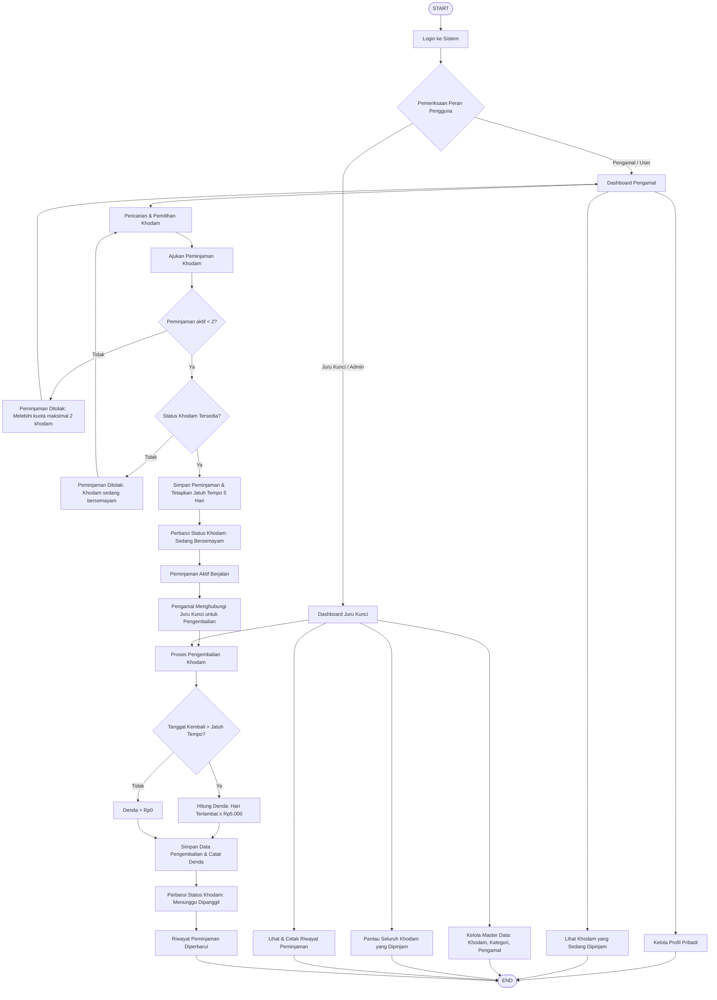
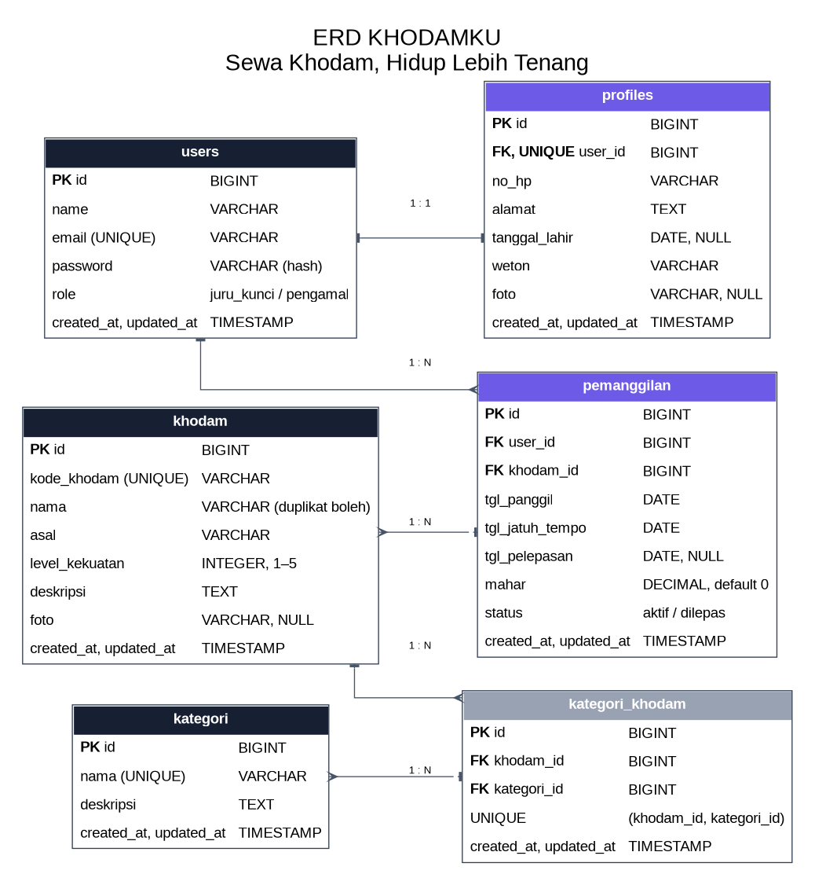
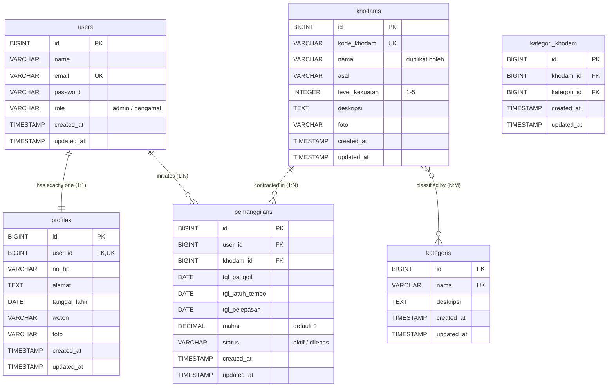

# DOKUMENTASI FLOWCHART & ENTITY RELATIONSHIP DIAGRAM (ERD)
# KhodamKu: Sewa Khodam, Hidup Lebih Tenang

---

## 1. Pendahuluan

Dokumen ini mendokumentasikan rancangan arsitektur proses bisnis (*Business Process Flowchart*) dan rancangan skema basis data relasional (*Entity Relationship Diagram / ERD*) dari aplikasi **KhodamKu**. Dokumen ini menjadi jembatan visual dan logis antara kebutuhan bisnis (**BRD**), kebutuhan produk (**PRD**), serta implementasi teknis pada kode Laravel dan Next.js.

---

## 2. Diagram Alur Kerja Sistem (System Flowchart)

### 2.1 Visualisasi Alur Bisnis Peminjaman & Pengembalian Khodam

### 2.2 Diagram Alur Logika (Mermaid Diagram)

### 2.3 Analisis Tahapan Logika Alur Bisnis

1. **Autentikasi & Pemeriksaan Peran:**
   - Semua aktor wajib melewati gerbang login terpusat.
   - Sistem membaca atribut `role` dari pengguna: jika `admin` diarahkan ke ekosistem Juru Kunci, jika `pengamal` diarahkan ke ekosistem Pengamal.
2. **Penegakan Batasan Kuota Peminjaman (BR-01):**
   - Raga seorang pengamal dibatasi secara ketat hanya dapat menampung maksimal 2 pemanggilan khodam aktif secara bersamaan.
   - Jika kuota sudah mencapai 2 unit, pengajuan pemanggilan ketiga langsung digugurkan oleh sistem.
3. **Pemeriksaan Ketersediaan Khodam (BR-02):**
   - Sistem memastikan khodam yang dipilih tidak sedang terikat (*Sedang Bersemayam*) pada pengamal lain.
4. **Pencatatan Transaksi & Durasi Kontrak (BR-03):**
   - Setelah validasi lolos, transaksi pemanggilan disimpan dengan tanggal panggil hari ini dan tanggal jatuh tempo otomatis $5\text{ hari}$ ke depan.
5. **Eksklusivitas Pengembalian oleh Admin (BR-06):**
   - Pengamal tidak memiliki otoritas melepas khodam secara mandiri. Pengamal menghubungi Juru Kunci via integrasi kontak.
6. **Perhitungan Denda Otomatis (BR-04, BR-05):**
   - Saat Juru Kunci memproses pelepasan, sistem membandingkan tanggal pengembalian aktual terhadap tanggal jatuh tempo.
   - Jika melewati jatuh tempo: $\text{Denda} = \text{Hari Terlambat} \times \text{Rp5.000}$.
   - Khodam yang telah dilepaskan otomatis berstatus *Menunggu Dipanggil* kembali.

---

## 3. Entity Relationship Diagram (ERD)

### 3.1 Skema Relasi Basis Data KhodamKu

### 3.2 Spesifikasi Relasi Antar Entitas (Mermaid ERD)

### 3.3 Penjelasan Relasi & Karakteristik Data

1. **`users` 1 : 1 `profiles`**
   - **Karakteristik:** Satu pengguna tepat memiliki satu profil pelengkap.
   - **Constraint:** Kolom `profiles.user_id` bertindak sebagai foreign key berindeks `UNIQUE`.
   - **Integritas:** Menggunakan `ON DELETE CASCADE` sehingga data profil terhapus otomatis jika pengguna dihapus.
2. **`users` 1 : N `pemanggilans`**
   - **Karakteristik:** Seorang pengamal dapat melakukan banyak transaksi pemanggilan khodam sepanjang waktu.
   - **Filter:** Digunakan untuk memfilter riwayat pribadi dan membatasi kuota maksimal 2 pemanggilan aktif.
3. **`khodams` 1 : N `pemanggilans`**
   - **Karakteristik:** Satu unit khodam dapat dipanggil dalam banyak riwayat transaksi peminjaman bergantian.
   - **Penentuan Status:** Status ketersediaan khodam dihitung dari transaksi pemanggilan yang berstatus `aktif`.
4. **`khodams` N : M `kategoris` (via `kategori_khodam`)**
   - **Karakteristik:** Satu unit khodam dapat memiliki banyak kategori tuah sekaligus, dan satu kategori dapat menaungi banyak khodam.
   - **Tabel Pivot:** `kategori_khodam` menyimpan pasangan `khodam_id` dan `kategori_id` dengan unique composite index `(khodam_id, kategori_id)`.
5. **Keunikan Kode vs Duplikasi Nama (Ketentuan 8 / BR-07):**
   - `khodams.kode_khodam` bersifat `UNIQUE` (wajib unik di seluruh sistem).
   - `khodams.nama` **tidak unik** (boleh duplikat), memungkinkan beberapa entitas memiliki nama sama (misal "Macan Putih") namun dibedakan secara tegas oleh kodenya.

---

**KhodamKu — Padepokan Spiritual Digital**  
*Kelompok 11 Web Development Certification Project · Hak Cipta © 2026*
