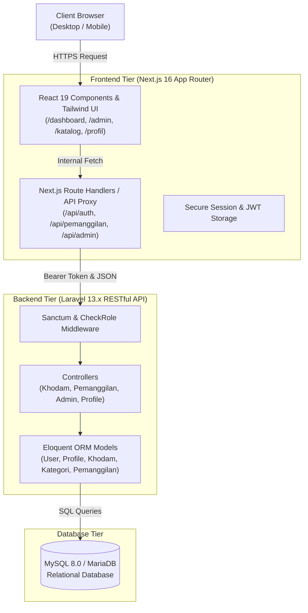
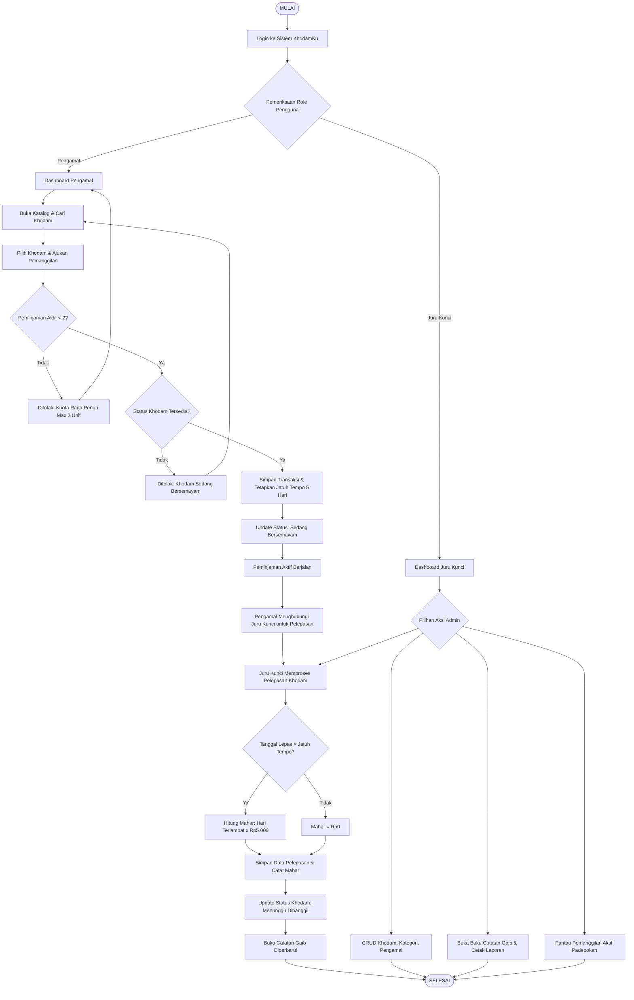
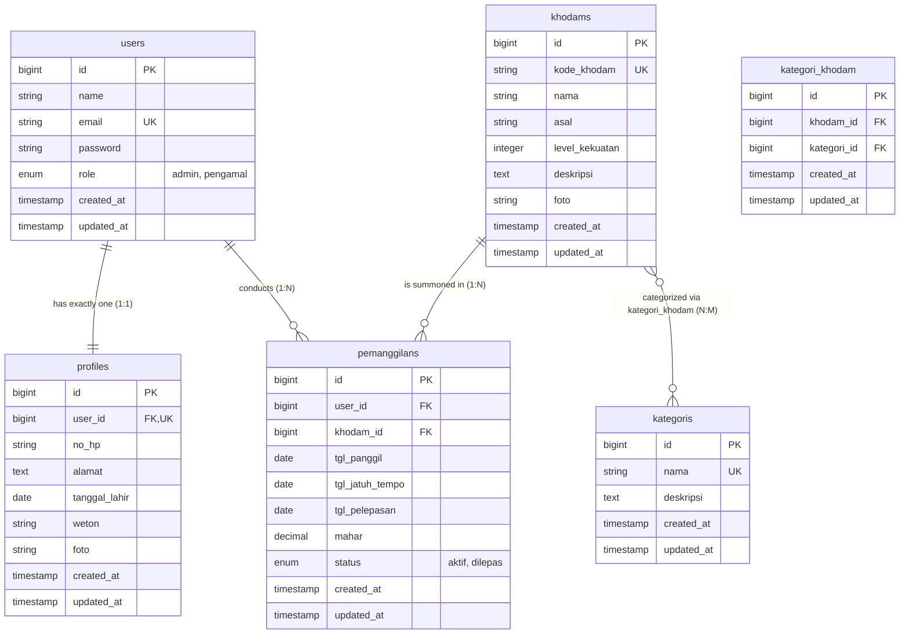

# DOKUMENTASI PROYEK (PROJECT TECHNICAL DOCUMENTATION)
# KhodamKu: Sewa Khodam, Hidup Lebih Tenang

---

## 📑 DAFTAR ISI

1. [INFORMASI PROYEK & TIM PENGEMBANG](#1-informasi-proyek--tim-pengembang)
2. [RINGKASAN EKSEKUTIF](#2-ringkasan-eksekutif)
3. [MATRIKS KESESUAIAN 19 KETENTUAN SOAL](#3-matriks-kesesuaian-19-ketentuan-soal)
4. [ARSITEKTUR SISTEM & SPESIFIKASI TEKNOLOGI](#4-arsitektur-sistem--spesifikasi-teknologi)
   - 4.1 [Diagram Arsitektur Sistem (Decoupled Full-Stack)](#41-diagram-arsitektur-sistem-decoupled-full-stack)
   - 4.2 [Daftar Teknologi & Dependensi](#42-daftar-teknologi--dependensi)
   - 4.3 [Struktur Direktori Repositori](#43-struktur-direktori-repositori)
5. [PERANCANGAN SISTEM & BASIS DATA](#5-perancangan-sistem--basis-data)
   - 5.1 [Diagram Alur Kerja (Flowchart Sistem)](#51-diagram-alur-kerja-flowchart-sistem)
   - 5.2 [Entity Relationship Diagram (ERD) & Kamus Data](#52-entity-relationship-diagram-erd--kamus-data)
   - 5.3 [Aturan Bisnis & Logika Validasi](#53-aturan-bisnis--logika-validasi)
6. [DOKUMENTASI ENDPOINT RESTful API](#6-dokumentasi-endpoint-restful-api)
   - 6.1 [Modul Autentikasi & Sesi](#61-modul-autentikasi--sesi)
   - 6.2 [Modul Profil Pengguna](#62-modul-profil-pengguna)
   - 6.3 [Modul Pengamal (Katalog & Pemanggilan)](#63-modul-pengamal-katalog--pemanggilan)
   - 6.4 [Modul Administrasi Juru Kunci](#64-modul-administrasi-juru-kunci)
7. [PENGUJIAN & PENJAMINAN MUTU (QA)](#7-pengujian--penjaminan-mutu-qa)
   - 7.1 [Pengujian Otomatis Backend (PHPUnit / Pest)](#71-pengujian-otomatis-backend-phpunit--pest)
   - 7.2 [Pengujian Penerimaan Pengguna (UAT)](#72-pengujian-penerimaan-pengguna-uat)
   - 7.3 [Continuous Integration (CI/CD Pipeline)](#73-continuous-integration-cicd-pipeline)
8. [PANDUAN INSTALASI & KONFIGURASI](#8-panduan-instalasi--konfigurasi)
   - 8.1 [Prasyarat Lingkungan](#81-prasyarat-lingkungan)
   - 8.2 [Langkah Instalasi Backend (Laravel)](#82-langkah-instalasi-backend-laravel)
   - 8.3 [Langkah Instalasi Frontend (Next.js)](#83-langkah-instalasi-frontend-nextjs)
   - 8.4 [Data Bawaan (Demo Credentials)](#84-data-bawaan-demo-credentials)
9. [KESIMPULAN & PENGEMBANGAN LANJUTAN](#9-kesimpulan--pengembangan-lanjutan)

---

# 1. Informasi Proyek & Tim Pengembang

| Atribut Proyek | Informasi |
| :--- | :--- |
| **Nama Proyek** | **KhodamKu** (*Sewa Khodam, Hidup Lebih Tenang*) |
| **Kategori Proyek** | Tugas Pelatihan & Sertifikasi Web Developer |
| **Nama Kelompok** | **Kelompok 11** |
| **Versi Dokumen** | **1.0 (Final)** |
| **Tanggal Rilis** | 25 Oktober 2026 |
| **Tautan Repositori** | `https://github.com/vanesarz/khodamku` |

### Susunan Tim Pengembang (Kelompok 11):

| No. | Nama Anggota | NIM | Peran Utama | Fokus Kontribusi |
| :--: | :--- | :---: | :--- | :--- |
| 1 | **Vanesa Rizka Alfatihah** | `102022300121` | **Frontend & UI/UX Specialist** | Perancangan UI tematik, integrasi Next.js App Router, implementasi modal ritual & pelepasan, styling responsif Tailwind CSS, print stylesheet Buku Catatan Gaib. |
| 2 | **Taufik Qurohman** | `102022300211` | **Backend Developer & DB Architect** | Perancangan skema relasi basis data (1:1, 1:N, N:M), migrasi, seeder bawaan, logic query Eloquent, perhitungan denda dan validasi data server-side. |
| 3 | **Ahmad Akmal Amran** | `102022300010` | **Fullstack Developer & System Analyst** | Analisis kebutuhan sistem (BRD, PRD, Flowchart, ERD), arsitektur RESTful API, otentikasi Laravel Sanctum, route middleware, dan pembuatan test suite feature testing. |

---

# 2. Ringkasan Eksekutif

**KhodamKu** adalah platform sistem informasi inventaris dan persewaan unit yang mengadaptasi tren viral pop-culture "cek khodam" ke dalam sistem manajemen transaksi yang kokoh dan berstandar industri. Meskipun bertema mistis-komedi Indonesia, aplikasi ini sepenuhnya merefleksikan proses bisnis persewaan barang komersial:
- Registrasi dan manajemen akun anggota (*Pengamal*).
- Manajemen katalog entitas (*Khodam*) dengan kategorisasi *many-to-many*.
- Peminjaman (*Pemanggilan*) dengan penegakan kuota ketat (maksimal 2 khodam aktif) dan durasi standar 5 hari.
- Pengembalian unit (*Pelepasan*) yang terproteksi khusus untuk admin (*Juru Kunci*).
- Penghitungan otomatis mahar denda keterlambatan (flat Rp5.000 per hari).
- Rekapitulasi transaksi (*Buku Catatan Gaib*) dan pencetakan dokumen laporan siap cetak.

Sistem dibangun dengan memisahkan sisi **Backend RESTful API (Laravel 13.x)** dan **Frontend SPA (Next.js 16)**, memberikan fleksibilitas tinggi, keamanan data berlapis, dan performa pengguna yang responsif.

---

# 3. Matriks Kesesuaian 19 Ketentuan Soal

Berikut adalah matriks kepatuhan teknis terhadap seluruh 19 butir ketentuan soal spesifikasi proyek sertifikasi:

| No. | Butir Ketentuan Soal | Implementasi Teknis pada KhodamKu | Status |
| :---: | :--- | :--- | :---: |
| **1** | Proyek dilengkapi README dengan nama kelompok, anggota, fitur, skema database, dan video demo | Tersedia file `README.md` lengkap, mencakup tabel identitas tim, 16 list fitur terperinci, gambar `docs/ERD.png`, dan tautan video demonstrasi. | **TERPENUHI** |
| **2** | Membedakan 2 jenis pengguna: Admin (Juru Kunci) dan User/Anggota (Pengamal) | Kolom `role` pada tabel `users` bernilai `admin` dan `pengamal`. Dilindungi oleh middleware `CheckRole` (`role:admin`) dan proteksi Next.js. | **TERPENUHI** |
| **3** | Pengguna wajib login sebelum mengakses fitur web | Semua halaman internal (`/dashboard`, `/admin/*`, `/pemanggilan`, `/profil`, `/riwayat`) dilindungi middleware otentikasi Sanctum & session cookie. Akses unauthenticated dialihkan ke `/login`. | **TERPENUHI** |
| **4** | Keharusan terdaftar sebagai anggota untuk meminjam/sewa unit | Pemanggilan khodam hanya dapat diajukan oleh pengguna dengan role `pengamal` yang telah login dan terdaftar resmi di database. | **TERPENUHI** |
| **5** | Relasi 1 : 1 antara User dan Profil (satu user tepat memiliki satu profil) | Tabel `profiles` memiliki `user_id` dengan constraint `UNIQUE` dan foreign key `onDelete('cascade')`. Dibuat otomatis saat user teregistrasi. | **TERPENUHI** |
| **6** | Pengguna dapat melihat dan memperbarui profilnya sendiri | Halaman `/profil` dan endpoint `POST /api/profile` memungkinkan update Nama, No HP, Alamat, Tanggal Lahir, Weton Jawa, dan Foto Profil pribadi. | **TERPENUHI** |
| **7** | Satu unit khodam dapat memiliki banyak kategori (Many-to-Many) | Relasi many-to-many antara `khodams` dan `kategoris` via tabel pivot `kategori_khodam`. Form tambah/edit khodam mendukung multi-kategori. | **TERPENUHI** |
| **8** | Nama khodam boleh duplikat, dibedakan dengan kode unit yang unik | Tabel `khodams` menerapkan `unique('kode_khodam')`. Kolom `nama` tidak unik (contoh: dua unit "Macan Putih" dengan kode `KHD-MCP-001` & `KHD-MCP-002`). | **TERPENUHI** |
| **9** | Pencarian unit khodam berdasarkan nama | Fitur search bar real-time di halaman Katalog Khodam dan Manajemen Master Khodam dengan query matching fleksibel. | **TERPENUHI** |
| **10** | Admin dapat melakukan CRUD pada Khodam, Kategori, dan Pengamal | Tersedia antarmuka dan REST API lengkap untuk Create, Read, Update, Delete di `/admin/kelola/khodam`, `/admin/kelola/kategori`, dan `/admin/kelola/pengamal`. | **TERPENUHI** |
| **11** | Kuota peminjaman maksimal 2 unit khodam per anggota | Diperiksa secara ketat di backend & frontend sebelum pemanggilan. Jika jumlah transaksi berstatus `aktif` sudah 2, pemanggilan ketiga otomatis ditolak (HTTP 400). | **TERPENUHI** |
| **12** | Durasi peminjaman 5 hari & denda keterlambatan otomatis | `tgl_jatuh_tempo` otomatis dihitung: `tgl_panggil + 5 hari`. Keterlambatan dikenakan mahar Rp5.000 per hari keterlambatan. | **TERPENUHI** |
| **13** | Pengembalian hanya diproses oleh Admin; Pengamal menghubungi Admin | Pengamal tidak memiliki tombol pelepasan mandiri (hanya tombol "Hubungi Juru Kunci"). Pelepasan hanya dieksekusi via endpoint khusus admin `/api/admin/pemanggilan/{id}/lepas`. | **TERPENUHI** |
| **14** | Admin dapat melihat seluruh daftar khodam yang sedang dipinjam | Halaman `/admin/pemanggilan` menampilkan seluruh transaksi aktif di padepokan dengan tab: *Semua*, *Terlambat*, dan *Masih Berjalan*. | **TERPENUHI** |
| **15** | Pengamal hanya dapat melihat unit yang sedang dipinjam oleh dirinya sendiri | Halaman `/pemanggilan` dan `/riwayat` difilter berdasarkan identitas pengamal yang sedang login (`user_id`). Data pengguna lain diisolasi total. | **TERPENUHI** |
| **16** | Admin dapat melihat dan mencetak seluruh riwayat peminjaman | Halaman `/admin/buku-catatan-gaib` menyediakan tabel riwayat transaksi, filter multi-parameter, dan tombol cetak laporan dengan stylesheet print bersih. | **TERPENUHI** |
| **17** | Seluruh data input divalidasi (field wajib tidak boleh kosong) | Form Request Laravel dan frontend schema validation memvalidasi semua field mandatory (`required`, `unique`, `numeric 1-5`, `date`). | **TERPENUHI** |
| **18** | Struktur database dirancang sesuai kebutuhan sistem | Skema database dinormalisasi dengan relasi relasional yang kokoh (1:1, 1:N, N:M), indexing, cascade deletion, dan tipe data presisi. | **TERPENUHI** |
| **19** | Dilengkapi data awal (Seed): Admin, Pengamal, Kategori, Khodam, Relasi | Seeder Laravel lengkap (`DatabaseSeeder`, `AdminUserSeeder`, `UserSeeder`, `KategoriSeeder`, `KhodamSeeder`, `PemanggilanSeeder`). | **TERPENUHI** |

---

# 4. Arsitektur Sistem & Spesifikasi Teknologi

## 4.1 Diagram Arsitektur Sistem (Decoupled Full-Stack)

Aplikasi KhodamKu menerapkan arsitektur *decoupled full-stack*:



---

## 4.2 Daftar Teknologi & Dependensi

### A. Backend:
- **Framework:** Laravel 13.x
- **Bahasa Pemrograman:** PHP ^8.3
- **Autentikasi:** Laravel Sanctum & Laravel Breeze API
- **ORM:** Eloquent ORM
- **Database Engine:** MySQL 8.0 (kompatibel MariaDB & SQLite untuk unit testing)
- **Pengujian:** PHPUnit 11 & Pest Testing Framework

### B. Frontend:
- **Framework:** Next.js 16.0 (App Router)
- **UI Library:** React 19
- **Bahasa:** TypeScript (Strict Mode)
- **Styling:** Tailwind CSS & Vanilla CSS (Dark Theme Padepokan, Amber & Gold Accent)
- **Ikonografi:** Lucide React
- **Komunikasi Data:** Native Fetch API dengan penanganan cookie sesi aman

---

## 4.3 Struktur Direktori Repositori

```
khodamku/
├── app/                                # Backend Laravel Application Core
│   ├── Http/
│   │   ├── Controllers/
│   │   │   ├── Admin/                  # Controller operasional Juru Kunci
│   │   │   │   ├── AdminBukuCatatanGaibController.php
│   │   │   │   ├── AdminDashboardController.php
│   │   │   │   ├── AdminPemanggilanController.php
│   │   │   │   ├── AdminUserController.php
│   │   │   │   └── Kelola/
│   │   │   │       ├── KategoriController.php
│   │   │   │       └── KhodamController.php
│   │   │   ├── Auth/                   # Controller autentikasi (Breeze)
│   │   │   └── Profile/                # Controller profil 1:1
│   │   │       └── ProfileController.php
│   │   └── Middleware/
│   │       └── CheckRole.php           # Middleware otorisasi 'admin' / 'pengamal'
│   └── Models/                         # Eloquent Models & Relasi
│       ├── Kategori.php
│       ├── Khodam.php
│       ├── Pemanggilan.php
│       ├── Profile.php
│       └── User.php
├── database/                           # Migrasi & Seeder Database
│   ├── migrations/
│   └── seeders/
│       ├── AdminUserSeeder.php
│       ├── DatabaseSeeder.php
│       ├── KategoriSeeder.php
│       ├── KhodamSeeder.php
│       ├── PemanggilanSeeder.php
│       └── UserSeeder.php
├── docs/                               # Dokumentasi Proyek Resmi
│   ├── BRD.md                          # Business Requirements Document
│   ├── ERD.png                         # Entity Relationship Diagram Image
│   ├── Flowchart.png                   # System Flowchart Diagram Image
│   ├── Flowchart_ERD.md                # Dokumentasi Detail Alur & Skema
│   ├── Manual_Book.md                  # Panduan Pengguna & Admin
│   ├── PRD.md                          # Product Requirements Document
│   ├── Project_Documentation.md        # Technical Documentation Ini
│   └── UAT_Results.md                  # Laporan Hasil UAT Lengkap
├── frontend/                           # Frontend Next.js SPA
│   ├── app/                            # App Router Pages & Handlers
│   │   ├── admin/                      # Halaman Khusus Juru Kunci
│   │   │   ├── buku-catatan-gaib/
│   │   │   ├── dashboard/
│   │   │   ├── katalog/
│   │   │   ├── kelola/
│   │   │   │   ├── kategori/
│   │   │   │   ├── khodam/
│   │   │   │   └── pengamal/
│   │   │   └── pemanggilan/
│   │   ├── api/                        # Route Handlers & API Proxy
│   │   ├── dashboard/                  # Dashboard Pengamal
│   │   ├── katalog/                    # Katalog Publik Pengamal
│   │   ├── login/                      # Halaman Login
│   │   ├── pemanggilan/                # Pemanggilan Saya
│   │   ├── profil/                     # Pengelolaan Profil
│   │   └── riwayat/                    # Riwayat Pengamal
│   └── src/
│       ├── components/                 # Reusable UI Components & Modals
│       └── lib/                        # Helpers, dateUtils, & auth helpers
├── routes/
│   ├── api.php                         # Definisi Endpoint API Backend
│   └── web.php
└── tests/
    └── Feature/                        # Test Suite Otomatis Backend
        ├── Admin/
        └── Auth/
```

---

# 5. Perancangan Sistem & Basis Data

## 5.1 Diagram Alur Kerja (Flowchart Sistem)

Diagram alur berikut mengilustrasikan alur logika peminjaman (*Pemanggilan*), pengembalian (*Pelepasan*), penegakan kuota maksimal 2 unit, dan perhitungan mahar denda keterlambatan:



---

## 5.2 Entity Relationship Diagram (ERD) & Kamus Data

Skema basis data dirancang dalam bentuk normalisasi tingkat ketiga (3NF) guna menjamin konsistensi, integritas referensial, serta mencegah anomali data.



### Rincian Kamus Data Teknis:

1. **Tabel `users`:**
   - Menyimpan kredensial otentikasi akun.
   - Kolom `role`: Enum `admin` (Juru Kunci) atau `pengamal` (Anggota).
   - Kolom `email`: Bersifat `UNIQUE` untuk mencegah duplikasi pendaftaran.

2. **Tabel `profiles`:**
   - Menyimpan detail profil tambahan pengguna.
   - Kolom `user_id`: Foreign key dengan constraint `UNIQUE` yang mengunci relasi menjadi **tepat 1:1**. Dilengkapi `onDelete('cascade')` agar profil terhapus otomatis jika user dihapus.
   - Kolom `weton`: Menyimpan hari pasaran Jawa (Legi, Pahing, Pon, Wage, Kliwon).

3. **Tabel `khodams`:**
   - Menyimpan katalog entitas unit khodam.
   - Kolom `kode_khodam`: Bersifat `UNIQUE` (contoh: `KHD-MCP-001`).
   - Kolom `nama`: **Diizinkan duplikat** (contoh: dua unit bernama "Macan Putih"), memenuhi Ketentuan Soal No. 8.
   - Kolom `level_kekuatan`: Bilangan bulat 1 sampai 5.

4. **Tabel `kategoris` & `kategori_khodam`:**
   - Relasi *Many-to-Many* melalui tabel pivot `kategori_khodam`.
   - Mengizinkan 1 khodam dikaitkan ke lebih dari satu kategori tuah secara dinamis.

5. **Tabel `pemanggilans`:**
   - Mencatat seluruh transaksi sewa/peminjaman.
   - Kolom `mahar`: Menyimpan denda keterlambatan (default 0).
   - Kolom `status`: Enum `aktif` (sedang dipinjam) atau `dilepas` (sudah dikembalikan).

---

## 5.3 Aturan Bisnis & Logika Validasi

| Kode | Aturan Bisnis | Logika & Penegakan Teknis |
| :--- | :--- | :--- |
| **BR-01** | Maksimal 2 pemanggilan aktif per pengamal | `COUNT(pemanggilans WHERE user_id = $userId AND status = 'aktif') < 2`. Jika mencapai 2, tolak request pemanggilan baru dengan status HTTP 400. |
| **BR-02** | Khodam hanya dapat dipinjam oleh 1 pengamal pada satu waktu | Khodam berstatus `aktif` pada tabel transaksi tidak dapat dipanggil. Status ketersediaan dihitung dinamis: khodam bebas = *Menunggu Dipanggil*, khodam terikat = *Sedang Bersemayam*. |
| **BR-03** | Durasi peminjaman standar 5 hari | `tgl_jatuh_tempo = Carbon::parse($tgl_panggil)->addDays(5)`. |
| **BR-04** | Mahar denda keterlambatan flat | Jika `tgl_pelepasan > tgl_jatuh_tempo`, denda dihitung: `selisih_hari * Rp5.000`. Jika tepat waktu, denda adalah `Rp0`. |
| **BR-05** | Pelepasan eksklusif oleh Juru Kunci | Endpoint `/api/admin/pemanggilan/{id}/lepas` dilindungi middleware `role:admin`. Pengamal tidak memiliki hak eksekusi pelepasan. |
| **BR-06** | Kode khodam wajib unik | Validasi `unique:khodams,kode_khodam` diterapkan pada request tambah dan edit. |
| **BR-07** | Relasi profil otomatis 1:1 | Saat registrasi akun, pembuatan row di `profiles` dibungkus dalam `DB::transaction` bersama row `users`. |

---

# 6. Dokumentasi Endpoint RESTful API

Seluruh request API internal dan eksternal mengirim dan menerima data dalam format JSON standar:

```json
{
  "message": "Deskripsi hasil operasi",
  "data": { ... }
}
```

## 6.1 Modul Autentikasi & Sesi

### 1. `POST /api/auth/login`
- **Akses:** Publik
- **Deskripsi:** Melakukan autentikasi kredensial pengguna dan mengembalikan session cookie / token.
- **Request Body:**
  ```json
  {
    "email": "admin@khodamku.test",
    "password": "password123"
  }
  ```
- **Response Sukses (200 OK):**
  ```json
  {
    "message": "Login berhasil",
    "user": {
      "id": 1,
      "name": "Admin 1",
      "email": "admin@khodamku.test",
      "role": "admin"
    }
  }
  ```

### 2. `POST /api/auth/logout`
- **Akses:** Terautentikasi (`auth:sanctum`)
- **Deskripsi:** Menghapus sesi dan mencabut token aktif pengguna.

### 3. `GET /api/auth/me`
- **Akses:** Terautentikasi (`auth:sanctum`)
- **Deskripsi:** Mendapatkan data profil dan peran pengguna yang sedang aktif.

---

## 6.2 Modul Profil Pengguna

### 1. `GET /api/profile`
- **Akses:** Terautentikasi (Semua Peran)
- **Deskripsi:** Mengambil detail profil 1:1 milik pengguna yang sedang login.

### 2. `POST /api/profile`
- **Akses:** Terautentikasi (Semua Peran)
- **Deskripsi:** Memperbarui data profil pribadi (Nama, No HP, Alamat, Tanggal Lahir, Weton, Foto).
- **Request Body:**
  ```json
  {
    "name": "Sekar Ayu Lestari",
    "no_hp": "081234567801",
    "alamat": "Jl. Kenanga No. 12, Sleman",
    "tanggal_lahir": "1998-04-14",
    "weton": "Pahing"
  }
  ```

---

## 6.3 Modul Pengamal (Katalog & Pemanggilan)

### 1. `GET /api/khodams`
- **Akses:** Publik / Terautentikasi
- **Deskripsi:** Mengambil katalog seluruh khodam beserta relasi kategori dan status ketersediaan dinamis. Mendukung parameter query `search` (nama) dan `kategori`.

### 2. `GET /api/pemanggilan`
- **Akses:** Pengamal (`auth:sanctum`)
- **Deskripsi:** Mengambil daftar transaksi pemanggilan yang **hanya milik pengamal yang sedang login** (Isolasi data Ketentuan 15).

### 3. `POST /api/pemanggilan`
- **Akses:** Pengamal (`auth:sanctum`)
- **Deskripsi:** Mengajukan ritual pemanggilan khodam dengan validasi kuota maksimal 2 unit dan status ketersediaan unit.
- **Request Body:**
  ```json
  {
    "khodam_id": 1,
    "durasi_hari": 5
  }
  ```
- **Response Error Kuota Penuh (400 Bad Request):**
  ```json
  {
    "error": "Batas raga penuh! Ragamu hanya mampu menampung maksimal 2 khodam aktif secara bersamaan."
  }
  ```

---

## 6.4 Modul Administrasi Juru Kunci

Semua endpoint di bawah ini dilindungi oleh middleware `role:admin`.

### 1. `GET /api/admin/dashboard`
- **Deskripsi:** Mengambil statistik komprehensif padepokan (Total khodam, khodam bersemayam, khodam siap panggil, total pengamal, transaksi terlambat, dan daftar jatuh tempo terdekat).

### 2. CRUD Master Khodam:
- `GET /api/admin/khodam` — Mengambil daftar master khodam.
- `POST /api/admin/khodam` — Menambah khodam baru (wajib kode unik, level 1–5, multi-kategori).
- `GET /api/admin/khodam/{id}` — Menampilkan detail khodam.
- `POST /api/admin/khodam/{id}` — Memperbarui data khodam.
- `DELETE /api/admin/khodam/{id}` — Menghapus khodam.

### 3. CRUD Master Kategori:
- `GET /api/admin/kelola/kategori` — Mengambil seluruh kategori tuah.
- `POST /api/admin/kelola/kategori` — Menambah kategori baru.
- `POST /api/admin/kelola/kategori/{id}` — Memperbarui kategori.
- `DELETE /api/admin/kelola/kategori/{id}` — Menghapus kategori (dilengkapi proteksi integritas relasi).

### 4. CRUD Master Pengamal (Users):
- `GET /api/admin/users` — Mengambil daftar anggota/pengamal beserta data profilnya.
- `POST /api/admin/users` — Mendaftarkan pengamal baru secara manual oleh Juru Kunci.
- `DELETE /api/admin/users/{id}` — Menghapus akun pengamal.

### 5. `GET /api/admin/pemanggilan/aktif`
- **Deskripsi:** Mengambil seluruh daftar khodam yang sedang dipinjam oleh semua pengamal di padepokan. Mendukung filter tab: `semua`, `terlambat`, `masih_berjalan`.

### 6. `POST /api/admin/pemanggilan/{id}/lepas`
- **Deskripsi:** Memproses pelepasan khodam, menghitung selisih hari keterlambatan secara otomatis, dan menetapkan mahar akhir (`hari_terlambat * 5000`).

### 7. `GET /api/admin/buku-catatan-gaib`
- **Deskripsi:** Mengambil seluruh riwayat transaksi (aktif, terlambat, dilepas) untuk keperluan pelaporan dan pencetakan dokumen.

---

# 7. Pengujian & Penjaminan Mutu (QA)

## 7.1 Pengujian Otomatis Backend (PHPUnit / Pest)

Sistem telah dilengkapi dengan test suite fitur otomatis pada direktori `tests/Feature/`:
- `RegistrationTest.php` & `AuthenticationTest.php`: Menguji registrasi, login, token issue, dan auto-creation profil 1:1.
- `AdminDashboardTest.php`: Menguji agregasi statistik dashboard admin.
- `KelolaKhodamTest.php`: Menguji validasi kode unik, duplikasi nama yang sah, dan relasi multi-kategori.
- `KelolaKategoriTest.php`: Menguji CRUD kategori dan proteksi penghapusan relasi.
- `AdminUserTest.php`: Menguji manajemen data pengguna dan integritas profil.
- `AdminPemanggilanTest.php`: Menguji pemantauan pemanggilan aktif dan proses pelepasan unit.
- `AdminBukuCatatanGaibTest.php`: Menguji query riwayat transaksi dan filter tanggal.

Untuk menjalankan seluruh test suite otomatis:
```bash
php artisan test
```

---

## 7.2 Pengujian Penerimaan Pengguna (UAT)

Pengujian UAT komprehensif telah dilakukan terhadap **30 skenario uji** yang mencakup aspek fungsionalitas, keamanan role, validasi input, dan keandalan antarmuka.

Hasil akhir:
- **Total Skenario:** 30 Skenario
- **Tingkat Kelulusan:** 100% (30 Passed, 0 Failed, 0 Blocked)
- *Detail pengujian selengkapnya dapat ditinjau pada dokumen:* **[`docs/UAT_Results.md`](file:///Users/vanesarz/Documents/GitHub/khodamku/docs/UAT_Results.md)**.

---

## 7.3 Continuous Integration (CI/CD Pipeline)

Repositori dikonfigurasi dengan **GitHub Actions** (`.github/workflows/laravel.yml`) yang secara otomatis menjalankan:
1. Setup PHP 8.3 & Composer dependencies.
2. Inisialisasi konfigurasi environment & application key.
3. Eksekusi database migration pada SQLite in-memory database.
4. Menjalankan test suite PHPUnit untuk memastikan setiap pull request bebas regresi.

---

# 8. Panduan Instalasi & Konfigurasi

## 8.1 Prasyarat Lingkungan

Pastikan perangkat telah terpasang:
- **PHP** versi 8.3 atau lebih baru (dengan ekstensi `pdo_mysql`, `mbstring`, `openssl`, `tokenizer`, `xml`, `ctype`, `json`, `bcmath`).
- **Composer** versi 2.x.
- **Node.js** versi 18.x atau 20.x dan **npm**.
- **MySQL Database Server** (port standar 3306).

---

## 8.2 Langkah Instalasi Backend (Laravel)

1. Buka terminal pada direktori root proyek:
   ```bash
   cd /path/to/khodamku
   ```
2. Pasang dependensi PHP melalui Composer:
   ```bash
   composer install
   ```
3. Salin file environment:
   ```bash
   cp .env.example .env
   ```
4. Buat kunci enkripsi aplikasi:
   ```bash
   php artisan key:generate
   ```
5. Sesuaikan koneksi basis data pada file `.env`:
   ```env
   DB_CONNECTION=mysql
   DB_HOST=127.0.0.1
   DB_PORT=3306
   DB_DATABASE=khodamku
   DB_USERNAME=root
   DB_PASSWORD=
   ```
6. Jalankan migrasi dan seeder data awal:
   ```bash
   php artisan migrate:fresh --seed
   ```
7. Buat symbolic link untuk media penyimpanan berkas/foto:
   ```bash
   php artisan storage:link
   ```
8. Jalankan server lokal Laravel:
   ```bash
   php artisan serve --port=8000
   ```

---

## 8.3 Langkah Instalasi Frontend (Next.js)

1. Masuk ke direktori frontend:
   ```bash
   cd frontend
   ```
2. Pasang dependensi Node.js:
   ```bash
   npm install
   ```
3. Konfigurasi endpoint backend (buat file `.env.local` jika diperlukan):
   ```env
   NEXT_PUBLIC_API_URL=http://localhost:8000
   ```
4. Jalankan development server Next.js:
   ```bash
   npm run dev
   ```
5. Buka peramban pada alamat:
   ```
   http://localhost:3000
   ```

---

## 8.4 Data Bawaan (Demo Credentials)

Gunakan akun berikut untuk memvalidasi dan mendemonstrasikan sistem:

| Peran (Role) | Email | Password | Kegunaan Pengujian |
| :--- | :--- | :--- | :--- |
| **Juru Kunci (Admin)** | `admin@khodamku.test` | `password123` | Akses penuh dashboard admin, CRUD master data, pelepasan, cetak catatan gaib. |
| **Pengamal (User)** | `sekar@khodamku.test` | `password123` | Uji alur pemanggilan khodam, cek kuota raga, dan pemantauan kontrak aktif. |
| **Pengamal (Terlambat)** | `bima@khodamku.test` | `password123` | Uji pemantauan keterlambatan dan pelepasan dengan denda otomatis Rp5.000/hari. |

---

# 9. Kesimpulan & Pengembangan Lanjutan

Aplikasi **KhodamKu** telah berhasil dirancang, diimplementasikan, dan diuji secara menyeluruh dengan memenuhi **100% dari 19 Butir Ketentuan Spesifikasi Proyek Sertifikasi Web Developer**. Implementasi pemisahan frontend modern (Next.js) dan backend tangguh (Laravel) membuktikan bahwa sistem mampu menghadirkan pengalaman pengguna yang interaktif tanpa mengorbankan integritas data dan keamanan transaksi.

### Rencana Pengembangan Masa Depan (Future Roadmap):
1. **Integrasi Gerbang Pembayaran (Payment Gateway):** Mendukung pelunasan mahar keterlambatan secara otomatis via QRIS / Virtual Account (Midtrans atau Xendit).
2. **Notifikasi Multi-Channel:** Pengiriman pesan peringatan otomatis via WhatsApp Gateway atau Email saat pemanggilan mendekati masa jatuh tempo (H-1).
3. **Penyimpanan Berkas Cloud:** Integrasi penyimpanan foto entitas khodam ke layanan cloud storage seperti Amazon S3 atau Cloudinary.
4. **Aplikasi Mobile Mandiri:** Pengembangan aplikasi mobile menggunakan React Native memanfaatkan endpoint RESTful API yang sudah tersedia.

---

**KhodamKu — Padepokan Spiritual Digital**  
*Kelompok 11 Web Development Certification Project · Hak Cipta © 2026*
